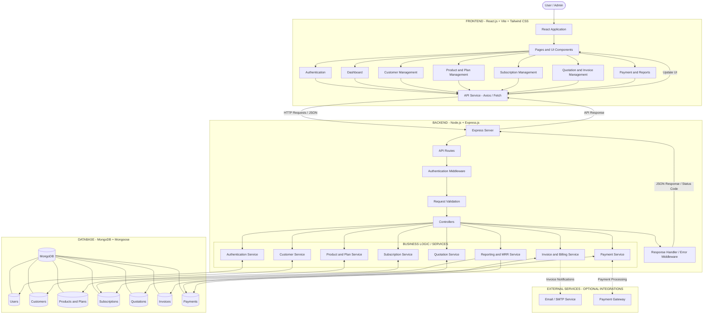
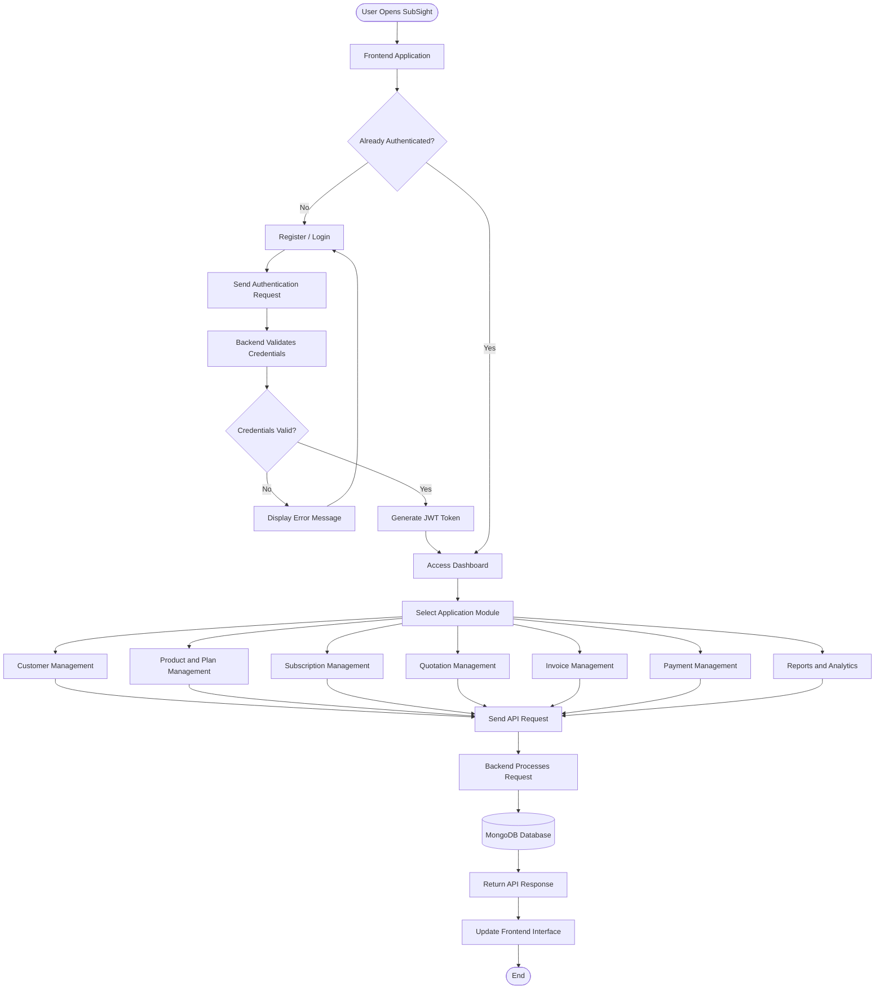
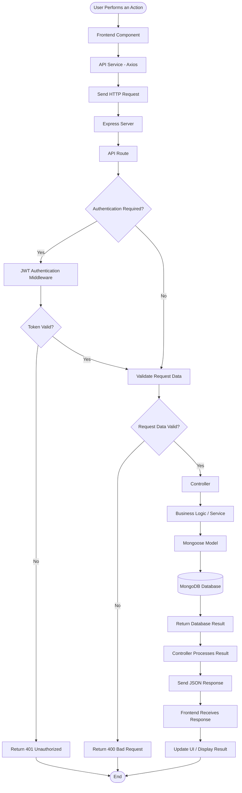
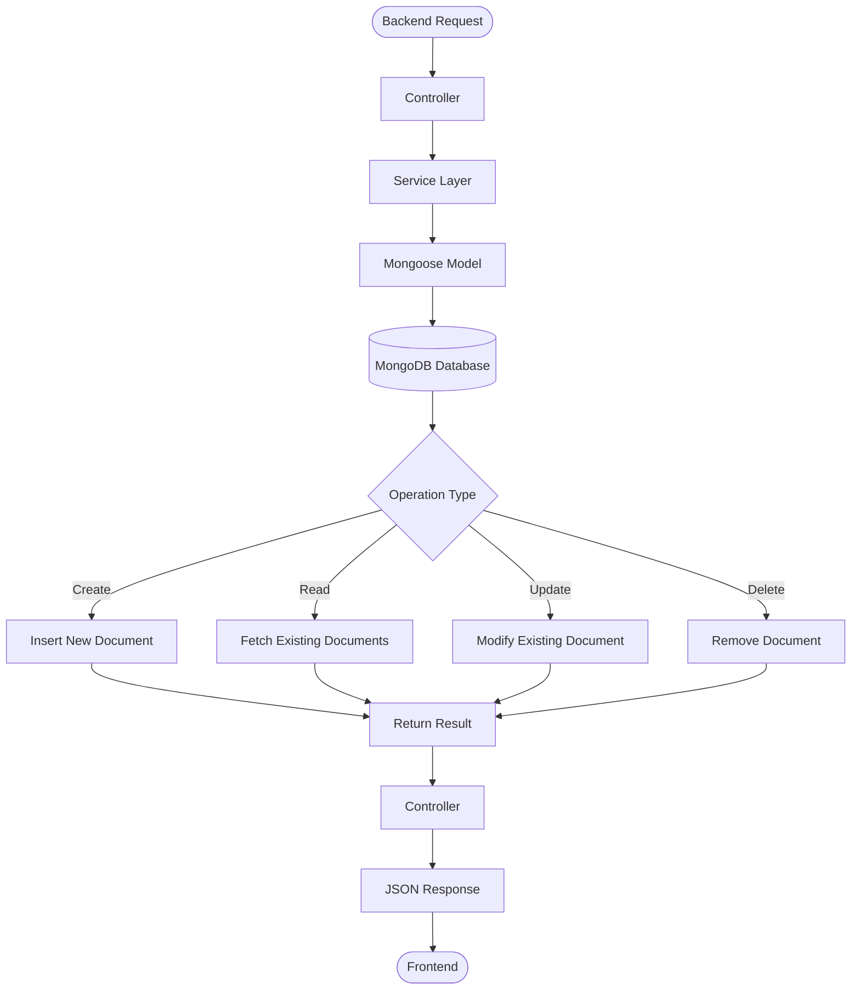
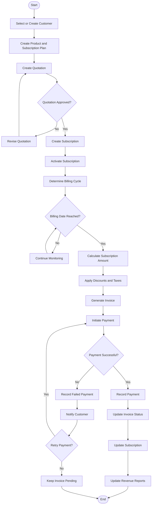
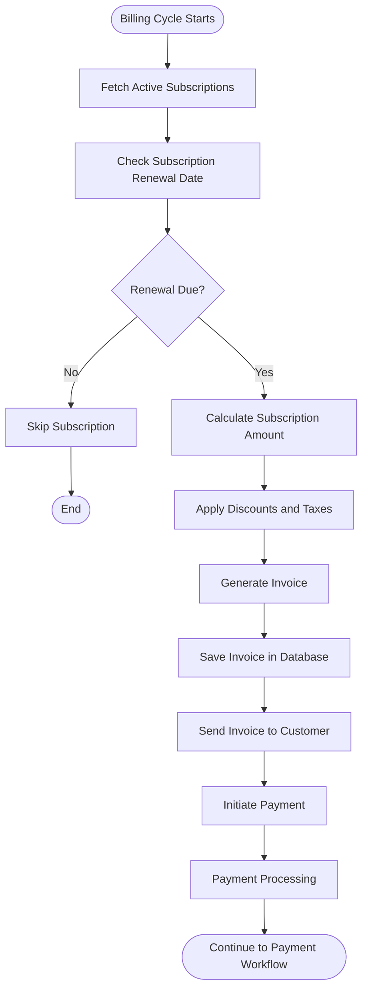
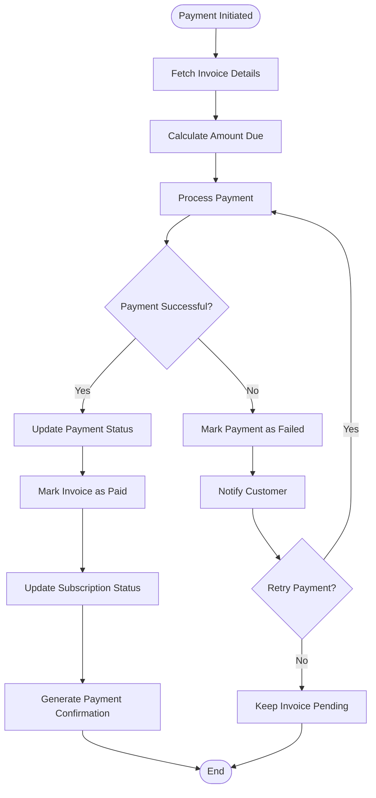
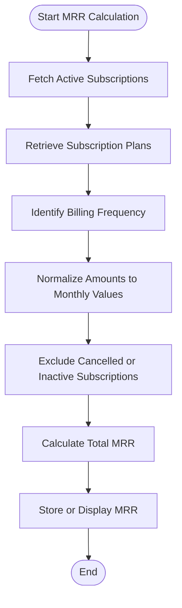

# SubSight
### Subscription Management & Billing Automation Platform

SubSight is a unified subscription management and billing platform designed to simplify and streamline subscription-based business operations. It provides a centralized workspace to manage customers, products, subscription plans, quotations, invoices, payments, and recurring billing processes.

The platform aims to improve billing efficiency, maintain accurate financial records, automate subscription workflows, and provide better visibility into business performance.

---

## Table of Contents

1. [Project Overview](#project-overview)
2. [Key Features](#key-features)
3. [Technology Stack](#technology-stack)
4. [System Architecture](#system-architecture)
5. [Complete Application Workflow](#complete-application-workflow)
6. [Backend Request-Response Flow](#backend-request-response-flow)
7. [Database Architecture](#database-architecture)
8. [Subscription and Billing Workflow](#subscription-and-billing-workflow)
9. [Project Structure](#project-structure)
10. [Installation and Setup](#installation-and-setup)
11. [Environment Variables](#environment-variables)
12. [Running the Application](#running-the-application)
13. [Security](#security)
14. [Future Enhancements](#future-enhancements)
15. [License](#license)

---

## 1. Project Overview

Managing a subscription-based business involves several interconnected processes, including customer onboarding, plan management, subscription activation, recurring billing, invoice generation, and payment tracking.

SubSight aims to bring these operations together in one platform.

The system follows a structured workflow:

**Customer Management → Product and Plan Management → Quotations → Subscriptions → Invoices → Payments → Reports**

By connecting these modules, SubSight provides a centralized approach to managing the complete subscription lifecycle.

## 2. Key Features

### Customer Management
- Maintain customer information and records.
- Organize customer details in a centralized system.
- Associate customers with subscriptions and invoices.

### Product and Plan Management
- Create and manage products and subscription plans.
- Define subscription pricing and billing frequencies.
- Maintain plan-related information.

### Subscription Management
- Create and manage customer subscriptions.
- Track subscription status and lifecycle.
- Manage subscription renewals and cancellations.

### Quotation Management
- Create quotations for customers.
- Manage quotation details and approval workflows.
- Convert approved quotations into subscriptions.

### Invoice Management
- Generate invoices for subscriptions.
- Maintain invoice records and payment status.
- Track outstanding and completed invoices.

### Billing and Payment Management
- Support recurring billing workflows.
- Calculate applicable subscription charges.
- Maintain payment records and transaction statuses.

### Reports and Analytics
- Provide visibility into subscription and billing information.
- Track revenue-related information.
- Support Monthly Recurring Revenue (MRR) analysis.

---

## 3. Technology Stack

| Layer | Technologies |
|---|---|
| Frontend | React.js, Vite |
| Styling | Tailwind CSS |
| Backend | Node.js, Express.js |
| Database | MongoDB |
| ODM | Mongoose |
| Authentication | JSON Web Tokens (JWT) |
| API Communication | REST APIs |
| Package Management | npm |
| Version Control | Git and GitHub |

---

## 4. System Architecture

SubSight follows a client-server architecture in which the frontend communicates with the backend through REST APIs. The backend handles authentication, request validation, business logic, and database operations.

MongoDB is used for data persistence, with Mongoose providing structured database interactions.

### 4.1 Complete System Architecture Flowchart



### 4.2 Architecture Components

| Component | Responsibility |
|---|---|
| React Frontend | Displays the application interface and handles user interactions. |
| API Layer | Sends HTTP requests from the frontend to the backend. |
| Express Server | Handles incoming API requests. |
| Routes | Direct requests to the appropriate backend operations. |
| Authentication Middleware | Verifies JWT tokens for protected operations. |
| Controllers | Handle requests and prepare responses. |
| Services | Manage application-specific business logic. |
| Mongoose Models | Define and manage database interactions. |
| MongoDB | Stores application data. |

---

## 5. Complete Application Workflow

This section illustrates how a user interacts with the different modules of SubSight.

### 5.1 Application Workflow Flowchart



---

## 6. Backend Request-Response Flow

The backend acts as the central processing layer of SubSight. Every frontend request is sent to an appropriate API endpoint, processed by the backend, and returned as a response.

### 6.1 Request-Response Flowchart



### 6.2 Backend Processing Responsibilities

1. Receive requests from the frontend.
2. Identify the appropriate API route.
3. Authenticate users where required.
4. Validate incoming request data.
5. Execute business logic through controllers and services.
6. Perform database operations using Mongoose.
7. Return appropriate JSON responses and HTTP status codes.

---

## 7. Database Architecture

SubSight uses MongoDB as its database and Mongoose for schema definition and database operations.

The database is responsible for storing customer information, user accounts, products, subscription plans, subscriptions, quotations, invoices, and payment records.

### 7.1 Database Interaction Flowchart



### 7.2 Main Data Collections

| Collection | Purpose |
|---|---|
| Users | Stores user account and authentication information. |
| Customers | Stores customer details. |
| Products | Stores product information. |
| Plans | Stores subscription plan details. |
| Subscriptions | Stores customer subscription records. |
| Quotations | Stores quotation details and statuses. |
| Invoices | Stores invoice information and billing records. |
| Payments | Stores payment and transaction information. |

*Note: The exact collections and their relationships should match the Mongoose models implemented in the backend.*

---

## 8. Subscription and Billing Workflow

Subscription and billing management form the core business workflow of SubSight.

The process starts with customer and plan selection, followed by quotation creation, subscription activation, invoice generation, and payment tracking.

### 8.1 Subscription Lifecycle Flowchart



### 8.2 Recurring Billing and Invoice Generation



### 8.3 Payment Processing Workflow



### 8.4 Monthly Recurring Revenue (MRR) Calculation

Monthly Recurring Revenue (MRR) represents the normalized monthly value of active recurring subscriptions.



**MRR Formula:**

For each active recurring subscription, convert its recurring price into a monthly equivalent and sum the values.

\[
MRR = \sum \text{Monthly Equivalent of Active Subscriptions}
\]

---

## 9. Project Structure

The following is an illustrative project structure. Adjust it according to the actual folders and files in the repository.

```text
SubSight/
│
├── backend/
│   ├── config/
│   ├── controllers/
│   ├── middleware/
│   ├── models/
│   ├── routes/
│   ├── services/
│   ├── utils/
│   ├── .env.example
│   ├── package.json
│   └── server.js
│
├── frontend/
│   ├── public/
│   ├── src/
│   │   ├── assets/
│   │   ├── components/
│   │   ├── pages/
│   │   ├── services/
│   │   ├── App.jsx
│   │   └── main.jsx
│   ├── index.html
│   └── package.json
│
├── README.md
├── .gitignore
└── LICENSE
```

---

## 10. Installation and Setup

### Prerequisites

Ensure that the following tools are installed:

- Node.js
- npm
- MongoDB
- Git

### Step 1: Clone the Repository

```bash
git clone https://github.com/Shivani-Meena07/Subscription_Management_System.git
```

### Step 2: Navigate to the Project

```bash
cd Subscription_Management_System
```

### Step 3: Install Backend Dependencies

```bash
cd backend
npm install
```

### Step 4: Configure Environment Variables

Create a `.env` file inside the backend directory and add the required configuration.

### Step 5: Start the Backend

```bash
npm run dev
```

### Step 6: Install Frontend Dependencies

Open a new terminal:

```bash
cd frontend
npm install
```

### Step 7: Start the Frontend

```bash
npm run dev
```

The frontend and backend will run on their configured local development ports.

---

## 11. Environment Variables

Create a `.env` file inside the backend directory.

Example:

```env
PORT=5000
MONGODB_URI=your_mongodb_connection_string
JWT_SECRET=your_secure_jwt_secret

ADMIN_PASSWORD=your_admin_password

SMTP_HOST=your_smtp_host
SMTP_PORT=your_smtp_port
SMTP_USER=your_smtp_username
SMTP_PASS=your_smtp_password
SMTP_FROM=your_sender_email
```

**Important:**
- Replace placeholder values with your actual configuration.
- Never commit `.env` files to GitHub.
- Keep database credentials and secret keys private.
- Configure only the variables required by your implemented application.

---

## 12. Running the Application

The application runs through two separate development processes:

| Application | Command |
|---|---|
| Backend | `npm run dev` |
| Frontend | `npm run dev` |

Start both processes in separate terminals.

Ensure MongoDB is running and the connection string is correctly configured before testing database-dependent functionality.

---

## 13. Security

SubSight is designed with security considerations including:

- JWT-based authentication.
- Password hashing.
- Protected backend routes.
- Request validation.
- Environment-based configuration.
- Secure handling of database credentials.
- Appropriate HTTP status codes and error handling.

Security measures should be enabled and verified in the actual implementation before deployment.

---

## 14. Future Enhancements

Potential improvements include:

- Automated recurring billing and scheduled invoice generation.
- Integration with payment gateways.
- Automated email notifications and invoice delivery.
- Advanced revenue analytics and reporting dashboards.
- Subscription renewal reminders.
- Customer self-service subscription portal.
- Role-based access control.
- Exportable financial reports.
- Improved automated testing and monitoring.

---

## 15. License

This project is intended for educational and development purposes.

Add the appropriate license file to the repository before distributing the project under an open-source license.

---

## Repository

**GitHub:** [Subscription Management System](https://github.com/Shivani-Meena07/Subscription_Management_System)

**Project Name:** SubSight

**Category:** Subscription Management & Billing Automation Platform
